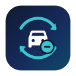
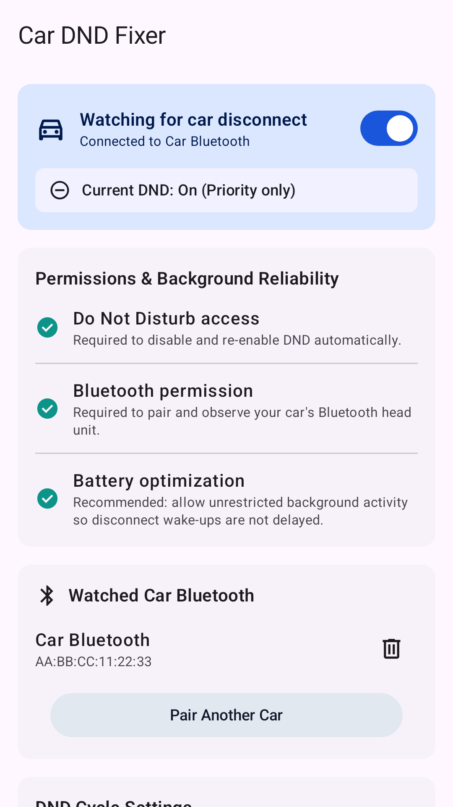

<p align="center">
  
</p>

<h1 align="center">cardndfixer</h1>

<p align="center">
  Standalone Do Not Disturb recovery utility for Android Auto &amp; car Bluetooth:<br>
  automatically cycles Do Not Disturb off and back on after disconnecting from your car.
</p>

<p align="center">
  <a href="https://github.com/Syxhen/cardndfixer/releases/latest"></a>
</p>

<p align="center">
  Android 12+ · Jetpack Compose &amp; Material 3 · CompanionDeviceService · no root · <a href="#install">install the APK</a>
</p>

<p align="center">
  <a href="#requirements"></a>
  <a href="#requirements"></a>
  <a href="https://github.com/Syxhen/cardndfixer/actions/workflows/ci.yml"></a>
  <a href="https://github.com/Syxhen/cardndfixer/releases"></a>
  <a href="LICENSE"></a>
</p>

<p align="center">
  
</p>

## The problem

On some Android devices and OEM builds, disconnecting from Android Auto or a
car Bluetooth head unit can leave **Do Not Disturb** in a stuck or inconsistent
state:

- Do Not Disturb stays stuck or stops respecting normal notification rules
  after a driving session ends;
- scheduled or previously active DND modes do not resume properly until DND is
  manually turned off and turned back on again;
- aggressive background-task limits often kill naive polling apps or legacy
  broadcast receivers before they can react to a disconnect.

**cardndfixer** is a universal, standalone utility that automates that
off-and-on reset using Android's `CompanionDeviceService`, letting the OS
itself wake the app when your car disconnects.

## How it works

1. You associate your car's Bluetooth head unit once inside the app through
   Android's system **Companion Device Manager** dialog.
2. Android binds `CarCompanionService` automatically whenever your car
   Bluetooth connects or disconnects — no persistent foreground notification or
   polling loop required.
3. On car disconnect:
   - waits a configurable **disconnect debounce** (default `3 s`), cancelling
     automatically if the car reconnects during a brief dropout;
   - checks the current Do Not Disturb filter via `NotificationManager`;
   - disables Do Not Disturb (`INTERRUPTION_FILTER_ALL`);
   - waits a configurable **re-enable delay** (default `1.5 s`) so Android
     flushes its DND state;
   - restores the exact previous DND filter (Priority, Alarms only, or Total
     silence) if DND was on — or leaves it off when *Only re-enable if DND was
     ON* is enabled.
4. Every connect, disconnect, and DND cycle is recorded in an on-device
   activity log (last 25 events), with an optional diagnostic log collector for
   troubleshooting.

## Requirements

- Android 12 (API 31) or later.
- A car head unit with Bluetooth (used by both Bluetooth-only setups and
  wired/wireless Android Auto).
- **Do Not Disturb access** (`ACCESS_NOTIFICATION_POLICY`) and **Bluetooth**
  (`BLUETOOTH_CONNECT`) permissions.
- No root required.

## Install

Each [release](https://github.com/Syxhen/cardndfixer/releases/latest) includes
two APKs:

- **`cardndfixer.apk`** — standard release build for everyday use (minified
  with R8, diagnostic log collection off by default).
- **`cardndfixer-debug.apk`** — side-by-side debug build (`Car DND Fixer
  (Debug)`) with diagnostic log collection enabled by default and built-in
  **Sim Connect / Sim Disconnect** buttons for testing without a car.

### Via ADB (recommended)

Installing with ADB avoids Android's sideloaded "Restricted setting" lock on
Do Not Disturb access:

```sh
adb install -r cardndfixer.apk
```

### Direct sideload on the phone

1. Download and open `cardndfixer.apk` on your phone to install it.
2. When you tap **Grant** for **Do Not Disturb access**, Android 13+ may show
   a *"Restricted setting"* notice. To allow it, open
   **Settings → Apps → Car DND Fixer → ⋮ (top-right menu) → Allow restricted
   settings**, then grant Do Not Disturb access again.

Test versions are published as **pre-releases** (tags like `v0.2.0-beta.1`)
and are not picked up by the `releases/latest` link.

## First-time setup

Open **Car DND Fixer** and complete the checklist on the home screen:

1. **Do Not Disturb access** — tap **Grant** and enable *Car DND Fixer*.
2. **Bluetooth permission** — tap **Allow**.
3. **Battery optimization** — tap **Settings** and allow unrestricted
   background activity so disconnect wake-ups are not delayed by aggressive
   power management.
4. **Test DND Cycle Now** — turn DND on manually and tap **Test DND Cycle
   Now** to verify the off → wait → on cycle behaves as expected on your phone.
5. **Pair Car Bluetooth** — while in or near your car, tap **Pair Car
   Bluetooth** and choose your car's Bluetooth head unit.

## Settings

All settings are stored locally with Jetpack DataStore and take effect
immediately:

| Setting | Default | Meaning |
|---|---|---|
| Automation toggle | `ON` | Master switch to pause or resume automatic cycling on disconnect |
| Re-enable delay | `1.5 s` | How long to keep DND off before turning it back on (`0.5 s`–`10.0 s`) |
| Wait after disconnect | `3 s` | Debounce window after Bluetooth disconnect before cycling (`0 s`–`15 s`) |
| Only re-enable if DND was ON | `ON` | Leaves DND off if it was not active at disconnect; disable to always re-enable Priority DND |
| Collect diagnostic logs | `OFF` (Release) / `ON` (Debug) | Records service lifecycle and DND filter transitions locally |

## Diagnostics & troubleshooting

If DND is not resetting reliably on your phone or car:

1. Enable **Collect diagnostic logs** in the **Diagnostics & Log Collector**
   card (or install the side-by-side `cardndfixer-debug.apk`).
2. Reproduce the disconnect (or use **Sim Connect** / **Sim Disconnect** in the
   debug build).
3. Tap **Share** or **Copy** to export the report. Bluetooth MAC addresses are
   automatically masked (`AA:BB:CC:**:**:**`) before export.
4. If the cycle runs too quickly after Android Auto exits, try raising **Wait
   after disconnect** to `5–8 s` and **Re-enable delay** to `2.0–3.0 s`.

## Limitations

- Detection relies on your car's Bluetooth connection via
  `CompanionDeviceService`. Even wired Android Auto normally connects to the
  car's Bluetooth for calls, so it triggers reliably on most vehicles, but
  head units without Bluetooth will not trigger automatically.
- If the user manually force-stops the app, Android will not bind
  `CompanionDeviceService` again until the app is opened once.

## Roadmap

- Quick Settings tile for one-tap manual DND cycling from the notification shade.
- Optional `androidx.car.app` `CarConnection` status indicator alongside Bluetooth presence.
- Option to snapshot DND state on car connect and restore that exact state on disconnect.

## Build & Tests

Requires JDK 25 (or Gradle daemon toolchain auto-provisioning) and Android SDK
platform 37:

```sh
./gradlew :app:testDebugUnitTest :app:assembleDebug :app:assembleRelease
```

Built APKs are written to:
- `app/build/outputs/apk/debug/cardndfixer-debug.apk`
- `app/build/outputs/apk/release/cardndfixer-release.apk` (or `-unsigned.apk` when signing env vars are not set)

GitHub Actions runs unit tests and builds both debug and release APKs on every
push and pull request.

## License

GPL-3.0-or-later. See [LICENSE](LICENSE).

## Development note

`cardndfixer` has been compiled and tested by the author, with a little help
from an agent for multi-testing and debugging purposes.
